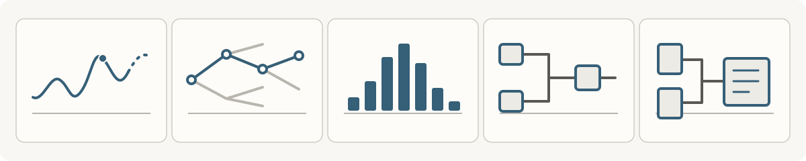
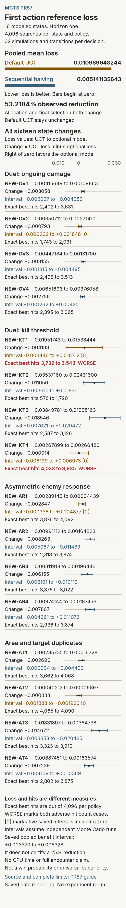
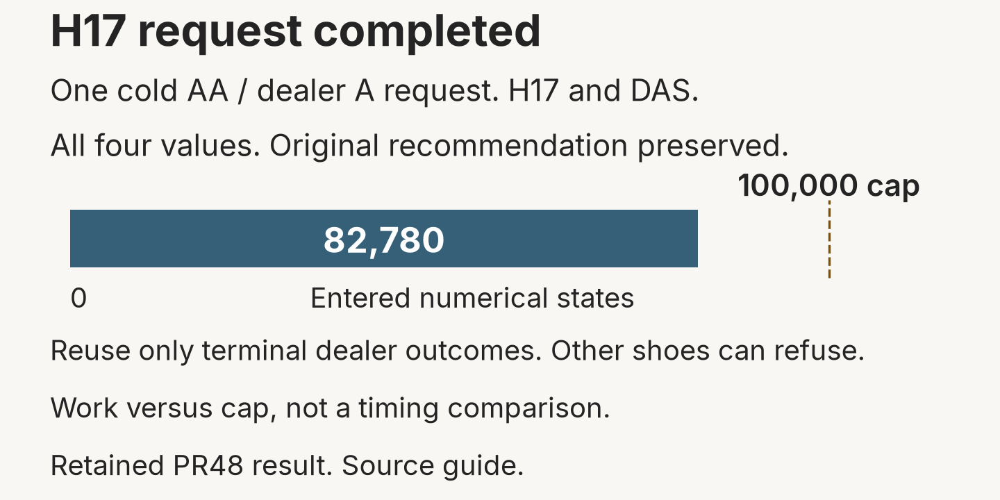

<picture>
  <source media="(prefers-color-scheme: dark)" srcset="assets/header-obscur.svg">
  <source media="(prefers-color-scheme: light)" srcset="assets/header-clair.svg">
  
</picture>

# Trinidy Farris

I build things because I want to understand how they work and how far I can take them.

I am an Air Force veteran studying computer science with an AI/ML concentration.
I expect to finish classes in December 2026 and graduate in February 2027.
My projects connect my logistics background with the systems, mathematics and
creative work that keep me curious.

These are passion projects. I spend weeks at a time on them, sometimes months.
I like getting something working, finding the detail I missed and figuring out
why it matters. I am looking for early career software and systems engineering
opportunities, especially work involving C++, Python, research tools and software assurance.

## Start with the work

| If you want to explore... | Start here |
| --- | --- |
| Native interfaces, ownership and performance | [Heterogeneous Batch Runtime](https://github.com/T92T1914/heterogeneous-batch-runtime) |
| PyTorch integration and native training operations | [Ragged Pooling for PyTorch](https://github.com/T92T1914/ragged-pool) |
| Search, evaluation and controlled execution | [MCTS Combat Engine](https://github.com/T92T1914/mcts-combat-engine) |
| Numerical models and expensive state spaces | [Exact Blackjack Solver](https://github.com/T92T1914/exact-blackjack-solver) |
| Historical data and interactive visualization | [Tornado Atlas](https://github.com/T92T1914/tornado-atlas) |
| Application state, access and retry behavior | [Shipment Exception Workspace](https://github.com/T92T1914/shipment-exception-workspace) |

### Heterogeneous Batch Runtime

My main systems project is a C++20 runtime with scalar, optimized CPU and optional
CUDA paths. Installed consumers can discover compiled backends without confusing
them with a working device. A separate image classifier connects ONNX Runtime
through C++. Each request owns its input and output, and an obsolete result
cannot replace the current one while its underlying work finishes. Optional
[model batching](https://github.com/T92T1914/heterogeneous-batch-runtime/blob/5d51afd321fc56e1e316ec3ce202d03cd6279146/docs/model-batching.md)
processes a nonempty batch of up to eight images in one invocation while serial
remains the default.

The retained inference comparisons check complete output tensors, session reuse
and memory. Reusing the C++ session reduced repeated call cost, but the direct
Python CPU baseline was faster at every tested batch size in both collections.
The CUDA followup records GPU operator placement. These results do not measure
recognition accuracy or establish general GPU superiority. A later
[batching study](https://github.com/T92T1914/heterogeneous-batch-runtime/blob/5d51afd321fc56e1e316ec3ce202d03cd6279146/docs/batching-results.md)
reduced complete request cost for two and eight images within each provider,
with CPU still faster in every tested batch. GPU sanitizer and
hardware counter acceptance remain open. HIP and SYCL are not implemented.

[Explore the project](https://t92t1914.github.io/heterogeneous-batch-runtime/) ·
[Read the CPU comparison](https://github.com/T92T1914/heterogeneous-batch-runtime/blob/e9346dac005e8dc4558b029cd813e260dce0236a/docs/inference-results.md) ·
[Read the CUDA followup](https://github.com/T92T1914/heterogeneous-batch-runtime/blob/e9346dac005e8dc4558b029cd813e260dce0236a/docs/inference-cuda-results.md) ·
[Inspect the backend contract](https://github.com/T92T1914/heterogeneous-batch-runtime/blob/e9346dac005e8dc4558b029cd813e260dce0236a/docs/backend-discovery.md)

### Ragged Pooling for PyTorch

Groups of data do not always have the same length. This small PyTorch component
combines each group into one vector using softmax weights. C++ handles the CPU
forward and backward operations, and Python connects them to training. The package
includes readable references, installed training examples and trusted model
exports for packed and padded inputs. The eager packed and padded CPU routes
also support second order gradients, including small training examples with
penalties on input gradients. Compiled training remains first order.

An optional CUDA companion supports eager packed training in float32 and float64.
The tested Windows RTX 4090 route passed installed gradient and model update
checks and six native diagnostic runs on the eager consumer. A separate fixed
shape `torch.compile` route uses `aot_eager` to capture forward and backward
graphs and check matched training updates. Those graphs run with eager PyTorch,
without optimized code generation or a speed claim. The compiled consumer has no
new sanitizer result.

Separate bounded CUDA routes now cover padded inputs, dynamic training, trusted
inference export and selected second derivatives. Later native derivative
binaries have no new sanitizer qualification. CUDA graph capture and broader
device portability remain outside the qualified scope.

The Linux CPU examples use two responsive ranks for unequal batches, accumulated
updates, continuation, clipping and shared numerical admission. These fixed
synthetic consumers do not establish GPU distributed training or general crash
recovery.

The studies use synthetic data and declared CPU environments. They do not establish
a general performance advantage or real world model accuracy. Third derivatives
remain outside the accepted routes.

[Inspect the component](https://github.com/T92T1914/ragged-pool) and
[read the supported contract](https://github.com/T92T1914/ragged-pool/blob/f2031fe8297df24c407413ac76856fc5feabe53b/docs/contract.md),
[packed second order boundary](https://github.com/T92T1914/ragged-pool/blob/f2031fe8297df24c407413ac76856fc5feabe53b/docs/second-order.md),
[padded second order boundary](https://github.com/T92T1914/ragged-pool/blob/f2031fe8297df24c407413ac76856fc5feabe53b/docs/padded-second-order.md)
and [trained padded export](https://github.com/T92T1914/ragged-pool/blob/f2031fe8297df24c407413ac76856fc5feabe53b/docs/padded-export.md).
The [CUDA contract](https://github.com/T92T1914/ragged-pool/blob/1cfc678d33bb34c036d8f0336ecfd986a6e97ea2/cuda/README.md),
[eager validation record](https://github.com/T92T1914/ragged-pool/blob/98a2748e8eca8fd03442c86e8504d9a03bd5c3bc/cuda/evidence/windows-sm89-20261021.json)
and [compiled validation record](https://github.com/T92T1914/ragged-pool/blob/fcbdb698cab1fc0549e9b27c7ec69b8e2cce69a4/cuda/evidence/compiled-windows-sm89-20261021.json)
describe these separate GPU checks.

The [Linux CPU training examples](https://github.com/T92T1914/ragged-pool/blob/1cfc678d33bb34c036d8f0336ecfd986a6e97ea2/docs/distributed-cpu.md) and [shared update admission](https://github.com/T92T1914/ragged-pool/blob/1cfc678d33bb34c036d8f0336ecfd986a6e97ea2/docs/distributed-admission.md) keep their separate contracts and controls.

<picture>
  <source media="(prefers-color-scheme: dark) and (max-width: 680px)" srcset="https://raw.githubusercontent.com/T92T1914/ragged-pool/91470d74a0559a5f6f0168deb27f27f87152d66a/docs/ragged-pool-obscur-narrow.png">
  <source media="(max-width: 680px)" srcset="https://raw.githubusercontent.com/T92T1914/ragged-pool/91470d74a0559a5f6f0168deb27f27f87152d66a/docs/ragged-pool-clair-narrow.png">
  <source media="(prefers-color-scheme: dark)" srcset="https://raw.githubusercontent.com/T92T1914/ragged-pool/91470d74a0559a5f6f0168deb27f27f87152d66a/docs/ragged-pool-obscur.png">
  
</picture>

### MCTS Combat Engine

Monte Carlo tree search samples possible futures to choose an action in a compact
turn based model. The Python engine stays separate from the companion that
records decisions and encounters, replays matching records without search and
inspects saved evidence.

An optional root allocation treatment reduced mean first action reference loss
by about 53.2 percent on sixteen controlled modeled states at a one round horizon.
Two cases had fewer exact best action hits, and five state uncertainty intervals
included zero. This measures the gap between the selected action and the best
action under the declared reference objective, not full encounter playing strength
or search speed.

The later prespecified encounter comparison was inconclusive about which policy
wins more often. Equal allowances per decision produced different total work.
The standard search policy remains the default.

The companion also provides Windows managed capture and passive recovery for a
small declared workload. It owns worker lifetimes, bounds retained output and
records incomplete or contradictory evidence. Recovery reads retained files
without retrying or replacing trials. These operational controls do not establish
better play, authenticate receipt origin or provide a hostile code sandbox.
A separate [installed Linux consumer](https://github.com/T92T1914/mcts-combat-engine/blob/d075b7ea94d32de178d8e6e766ab7c66bf8b101e/docs/linux-managed-episode.md)
records and replays through an existing local Docker daemon, with resource
accounting limited to its owned container and descendants.

[Explore the decisions](https://t92t1914.github.io/mcts-combat-engine/) ·
[Read the encounter finding](https://github.com/T92T1914/mcts-combat-engine/blob/2a8d2ac354415d765542d61b195dd01baf9c475c/docs/encounter-outcomes.md) ·
[Use the managed consumer](https://github.com/T92T1914/mcts-combat-engine/blob/2a8d2ac354415d765542d61b195dd01baf9c475c/docs/managed-encounters.md)

See all sixteen states in the frozen root allocation study

The figure retains both cases with fewer exact best action hits and all five
state intervals that include zero. It shows the accepted horizon one study,
with ordinary UCT still the default.

<a href="https://github.com/T92T1914/mcts-combat-engine/blob/0d516b9f8e779708f9139d67116198a87f9ced7f/docs/root-allocation.md">
  <picture>
    <source media="(prefers-color-scheme: dark)" srcset="assets/root-allocation-study-obscur.png">
    <source media="(prefers-color-scheme: light)" srcset="assets/root-allocation-study-clair.png">
    
  </picture>
</a>

<a href="https://github.com/T92T1914/mcts-combat-engine/blob/0d516b9f8e779708f9139d67116198a87f9ced7f/docs/root-allocation/results.json">Read the full deciding results</a>
and <a href="assets/project-figures.json">figure source record</a>.
The figure reuses saved evidence. It does not add a new experiment.

<a href="https://github.com/T92T1914/mcts-combat-engine/blob/main/docs/visual-example.md">
  <picture>
    <source media="(min-width: 1024px) and (prefers-color-scheme: dark)" srcset="https://raw.githubusercontent.com/T92T1914/mcts-combat-engine/main/docs/mcts-decision-obscur-wide.png">
    <source media="(min-width: 1024px) and (prefers-color-scheme: light)" srcset="https://raw.githubusercontent.com/T92T1914/mcts-combat-engine/main/docs/mcts-decision-clair-wide.png">
    <source media="(prefers-color-scheme: dark)" srcset="https://raw.githubusercontent.com/T92T1914/mcts-combat-engine/main/docs/mcts-decision-obscur.png">
    <source media="(prefers-color-scheme: light)" srcset="https://raw.githubusercontent.com/T92T1914/mcts-combat-engine/main/docs/mcts-decision-clair.png">
    
  </picture>
</a>

### Exact Blackjack Solver

The same hand total does not always mean the same decision when different cards
remain. This solver follows that distinction through explicit finite shoe models
and hidden dealer information. The original split path is approximate. Separate
bounded common shoe models preserve shared depletion and combined settlement,
with their own information and wager conventions.

One H17 ace request, where the dealer hits soft 17, returns all four original
action values at 82,780 states under the unchanged 100,000 state cap. This is one
specific completion result, not a general speedup or a full shoe guarantee.
[Completed settlement reuse](https://github.com/T92T1914/exact-blackjack-solver/blob/689a6ee94b8be3948ab384c869f3476a0e396773/docs/bounded-resplit-calculation.md#reuse-completed-settlement-states)
also lets two declared sixteen card non ace requests finish after earlier refusal,
without establishing lower latency or universal completion.
Installed calculation and replay commands preserve reusable records. The browser
inspector reads saved results without calculation or upload. Same engine replay
and independent mathematical checks remain different kinds of evidence.

[Explore the models](https://t92t1914.github.io/exact-blackjack-solver/#model-route) ·
[Calculate and replay the H17 request](https://github.com/T92T1914/exact-blackjack-solver#a-complete-h17-ace-calculation) ·
[Read the completion evidence](https://github.com/T92T1914/exact-blackjack-solver/blob/259aa8aedf84510887d8dbf3e5bf928c1447458a/docs/ace-terminal-reuse.md)

<a href="https://github.com/T92T1914/exact-blackjack-solver/blob/c5fa104375fca65404cfdf2ddda015d9eb6a54a2/docs/ace-terminal-reuse.md">
  <picture>
    <source media="(prefers-color-scheme: dark)" srcset="assets/ace-terminal-reuse-obscur.png">
    <source media="(prefers-color-scheme: light)" srcset="assets/ace-terminal-reuse-clair.png">
    
  </picture>
</a>

<a href="https://github.com/T92T1914/exact-blackjack-solver/blob/main/docs/visual-example.md">
  <picture>
    <source media="(min-width: 1024px) and (prefers-color-scheme: dark)" srcset="https://raw.githubusercontent.com/T92T1914/exact-blackjack-solver/main/docs/blackjack-composition-obscur-wide.png">
    <source media="(min-width: 1024px) and (prefers-color-scheme: light)" srcset="https://raw.githubusercontent.com/T92T1914/exact-blackjack-solver/main/docs/blackjack-composition-clair-wide.png">
    <source media="(prefers-color-scheme: dark)" srcset="https://raw.githubusercontent.com/T92T1914/exact-blackjack-solver/main/docs/blackjack-composition-obscur.png">
    <source media="(prefers-color-scheme: light)" srcset="https://raw.githubusercontent.com/T92T1914/exact-blackjack-solver/main/docs/blackjack-composition-clair.png">
    
  </picture>
</a>

### Tornado Atlas

I have always been interested in tornadoes. I wanted a way to study where they
went, what was documented and what we can actually say about how they looked.
Atlas combines a searchable NOAA record collection with six historical exhibits:
El Reno, Joplin, Blackwell, Tuscaloosa and Birmingham, Newcastle and Moore, and
Udall. Maps, photographs and evidence dossiers connect observations to their sources.

Reported times, camera observations and illustrative models remain separate.
The local research desk exports reviewed publication candidates without private
notes. The museum is usable now. Registered changing appearance and calibrated
historical damage remain unfinished research goals.

[Visit the museum](https://t92t1914.github.io/tornado-atlas/) ·
[Explore the record collection](https://t92t1914.github.io/tornado-atlas/atlas.html) ·
[Inspect the evidence dossiers](https://t92t1914.github.io/tornado-atlas/dossier.html)

## Supporting projects

### Shipment Exception Workspace

[Shipment Exception Workspace](https://github.com/T92T1914/shipment-exception-workspace)
is a local shipment review demo built with React and TypeScript, FastAPI and
PostgreSQL. Operators in the seeded organizations can create exceptions, search
and filter the queue, then assign or resolve a selected record. Reviewers can
inspect records and their history without changing them. Each change and its
history are recorded in the same transaction. Stale edits are refused, and a
retry that is still authorized can recover a committed result after a response
is lost.

Participating tabs recheck the shared session, clear old account state after
observed changes and discard delayed results from the previous context.
Recovery does not automatically repeat uncertain writes.

The [accepted workflow and limits](https://github.com/T92T1914/shipment-exception-workspace/blob/ca9f36f19d3433833f6f260b9eb1f4b3ed40bb03/README.md)
use synthetic records. There is no carrier integration or production deployment.

### Freight Forecast

My logistics background is the starting point for
[Freight Forecast](https://github.com/T92T1914/freight-forecast). It connects
chronological evaluation to a FastAPI service, containers and monitoring.
Synthetic shipments and the separate Bureau of Transportation Statistics freight
activity index stay distinct.
On that index, carrying forward the last observation beat the learned model.
The forecast ledger separates issuance, source revisions and corrections. Its
public example contains no real issued forecast.

<a href="https://github.com/T92T1914/freight-forecast/blob/main/docs/visual-example.md">
  <picture>
    <source media="(min-width: 1024px) and (prefers-color-scheme: dark)" srcset="https://raw.githubusercontent.com/T92T1914/freight-forecast/main/docs/freight-forecast-obscur-wide.png">
    <source media="(min-width: 1024px) and (prefers-color-scheme: light)" srcset="https://raw.githubusercontent.com/T92T1914/freight-forecast/main/docs/freight-forecast-clair-wide.png">
    <source media="(prefers-color-scheme: dark)" srcset="https://raw.githubusercontent.com/T92T1914/freight-forecast/main/docs/freight-forecast-obscur.png">
    <source media="(prefers-color-scheme: light)" srcset="https://raw.githubusercontent.com/T92T1914/freight-forecast/main/docs/freight-forecast-clair.png">
    
  </picture>
</a>

### Adaptive Timing Engine

[Adaptive Timing Engine](https://github.com/T92T1914/adaptive-timing-engine)
examines scheduling when work becomes obsolete. An
[installed consumer](https://github.com/T92T1914/adaptive-timing-engine/blob/9cadd27c8c72f07c371c54525671c0254a160f20/docs/revision-file.md)
runs finite local revisions through CPU analysis, keeping physical completion
separate from adoption of the current answer. Saved receipts can be checked
without executing the work. The trace explorer retains its generated workloads.
These studies do not establish real time guarantees or a validated model of
human behavior.

<a href="https://github.com/T92T1914/adaptive-timing-engine/blob/main/docs/visual-example.md">
  <picture>
    <source media="(min-width: 1024px) and (prefers-color-scheme: dark)" srcset="https://raw.githubusercontent.com/T92T1914/adaptive-timing-engine/main/docs/adaptive-timing-obscur-wide.png">
    <source media="(min-width: 1024px) and (prefers-color-scheme: light)" srcset="https://raw.githubusercontent.com/T92T1914/adaptive-timing-engine/main/docs/adaptive-timing-clair-wide.png">
    <source media="(prefers-color-scheme: dark)" srcset="https://raw.githubusercontent.com/T92T1914/adaptive-timing-engine/main/docs/adaptive-timing-obscur.png">
    <source media="(prefers-color-scheme: light)" srcset="https://raw.githubusercontent.com/T92T1914/adaptive-timing-engine/main/docs/adaptive-timing-clair.png">
    
  </picture>
</a>

### Clair and Obscur

[Clair and Obscur](https://t92t1914.github.io/clair-obscur-themes/) is a shared
visual theme family with downloadable packages and previews, installation guidance
and recovery instructions. Package and browser preview checks remain separate from complete
native compatibility, restart persistence, signing and store approval. The shared
palette also supplies a [Garmin watch face candidate](https://github.com/T92T1914/clair-obscur-themes/blob/4574e0350dbb6fc626e4e07b606c177188166861/docs/garmin-watchface.md)
and [phone icons](https://github.com/T92T1914/clair-obscur-themes/blob/4574e0350dbb6fc626e4e07b606c177188166861/docs/samsung-icons.md).
An earlier watch version has simulator acceptance. The current watch source has
its own unexecuted simulator and device checks. A scoped earlier phone theme was
applied, while full icon assignment, launcher behavior and restoration remain
separate checks.

## How I approach the work

I keep examples, tests, measurements and design notes close to the code because
I want to understand the decisions and be able to explain them. Sometimes the
useful result is an improvement. Sometimes the simpler approach wins or the
evidence does not settle the question.

These projects matter to me outside a job search. They are not claims of
deployment in a live logistics or emergency operation.

[My LinkedIn profile](https://www.linkedin.com/in/t92t1914/) has my experience and education.

[Read in another language](TRANSLATION.md): browser translation help, with code and evidence kept exact.
